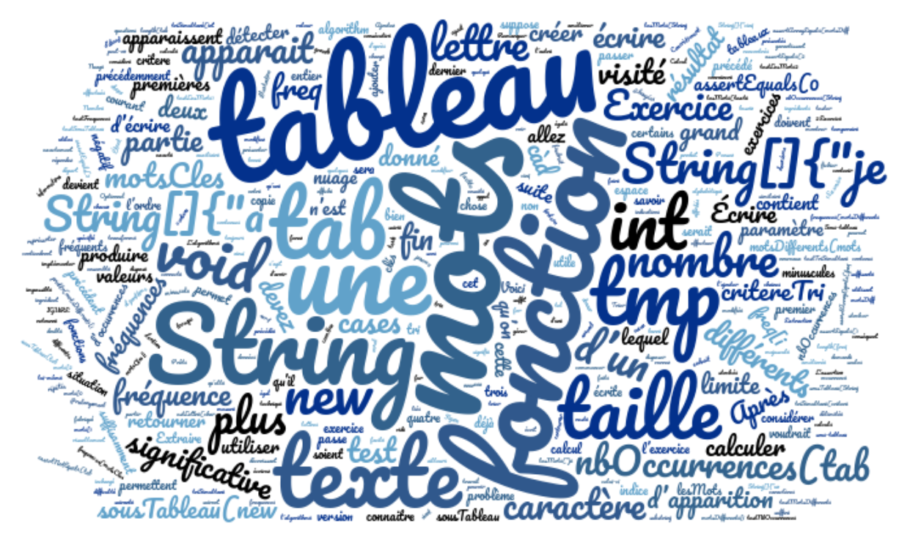

# Nuage de mots

Un nuage de mots permet de montrer visuellement la fréquence d’apparition de certains mots clés. Ainsi, le nuage de mots ci-dessous a été créé à partir des mots présents dans les énoncés des exercices de ce TP.  Les mots les plus grands sont ceux qui apparaissent le plus souvent.

Pour produire un nuage de mots, on a besoin de connaitre la fréquence d’apparition des différents mots clés. Dans les exercices qui suivent, vous allez implémenter un ensemble de fonctions qui permettent de partir d’un texte (une chaîne de caractères) et calculer la fréquence d’apparition de chacun des mots du texte.

::: question
**Par exemple, dans cette phrase qui n'est pas d'un intérêt transcendant, si ce n'est de vous faire lire un texte un peu longuet et pas trop passionnant ... et vérifier aussi votre compréhension de la notion de fréquence en vous demandant combien de fois le mot un est présent !**

- [x] 4 fois
  > Exactement, bien vu !
- [ ] 3 fois
  > Ah presque, mais n'avez-vous pas oublié le dernier à la fin de la phrase ?
- [ ] 2 fois
  > Hum, un peu plus, ce qui montre que c'est un peu laborieux comme traitement pour un humain ...
- [ ] franchement ...
  > Hé oui, d'accord avec vous, c'est pour cela qu'il est pratique que l'informatique ait été inventée ;)
:::

Vous devez faire les exercices dans l’ordre où ils sont présentés. Chaque exercice demande d’écrire une fonction et contient un test. À la fin, vous verrez comment les différentes fonctions permettent de calculer les fréquences d’apparition de chaque mot du texte.

Le dernier exercice consiste à regrouper toutes les fonctions écrites précédemment, afin de réaliser le calcul des fréquences des mots d'un texte ... qui est la base nécessaire pour créer ensuite un nuage de mots (ce que nous ne ferons malheureusement pas ;)).
